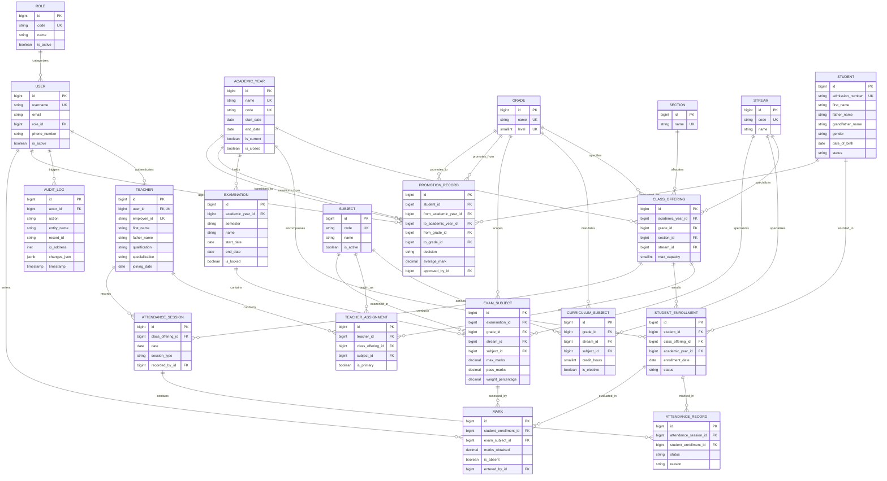

# Entity-Relationship Diagram (ERD)

**Project:** Smart School Management and Academic Information System (SSMS)  
**School Scope:** Grades 9–12, Majang Zone, Gambella Region, Ethiopia  

---

## 1. Complete Mermaid Entity-Relationship Diagram

---

## 2. Key Relationship Explanations

1. **Academic Year & Class Offerings (`1 : M`):**
   * An academic year (e.g., 2026/2027) establishes multiple `ClassOffering` instances (e.g., Grade 9-A, Grade 9-B, Grade 11-A Natural Science, Grade 11-B Social Science).
2. **Student & Historical Enrollment (`1 : M`):**
   * A `Student` is enrolled in exactly one `ClassOffering` per academic year via `StudentEnrollment`. When the student advances from Grade 9 to Grade 10 next year, a new enrollment record is added, preserving the Grade 9 enrollment forever.
3. **Teacher Allocations (`M : M` through `TeacherAssignment`):**
   * Teachers are mapped to specific subjects in specific class offerings, allowing a teacher to teach Physics to Grade 10-A, 10-B, and 11-A.
4. **Attendance Tracking (`1 : M` Session to Records):**
   * An `AttendanceSession` represents a single roll-call event. It contains one `AttendanceRecord` per enrolled student.
5. **Examinations & Mark Entries (`1 : M` and Junctions):**
   * An `Examination` contains multiple `ExamSubject` rows (e.g., Grade 10 Chemistry, max marks 100).
   * A `Mark` joins an individual `StudentEnrollment` with an `ExamSubject`.
6. **Promotion & Academic Progress (`1 : M`):**
   * `PromotionRecord` captures the year-end transition, storing the decision (`PROMOTED`, `RETAINED`, `GRADUATED`), final average, and Principal authorization.
