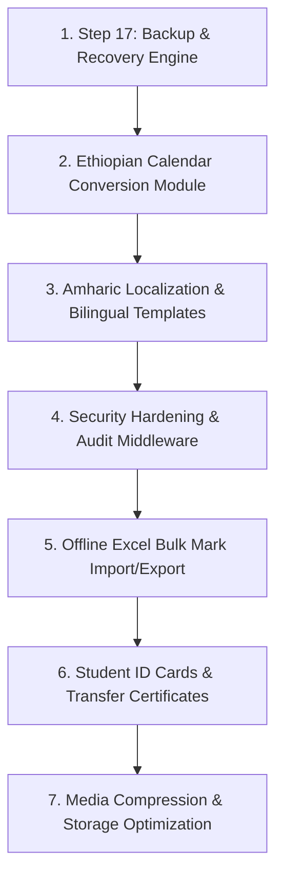

# FEATURE GAP ANALYSIS REPORT
**Project:** Smart School Management and Academic Information System (SSMS)  
**Target Deployment:** Secondary School (Grades 9–12, 1,000–2,000 Students), Majang Zone, Gambella Region, Ethiopia  
**Deployment Infrastructure:** Isolated Local Area Network (LAN) / Edge Server (No continuous internet connection)  
**Date of Assessment:** November 2026  
**Auditor:** Lead Systems Architect & Verification Agent  

---

## EXECUTIVE SUMMARY

A rigorous, code-level feature gap analysis of the Smart School Management and Academic Information System (SSMS) was conducted across all 15 operational, academic, security, and administrative dimensions. The inspection encompassed all database models, querysets, service classes, controllers (views), URL routing tables, Jinja2/Django templates, authentication decorators, static asset dependencies, and automated test suites.

### Core Metrics:
* **Django Configuration & System Checks:** `python manage.py check` reports `0 issues identified (0 silenced)`.
* **Database Migrations:** `makemigrations --check --dry-run` reports `No changes detected` across all 10 applications.
* **Automated Unit & Integration Test Suite:** **183 tests executed, 183 passed (100% pass rate in 23.86s)**.
* **HTTP Endpoint Health:** 29 core operational views tested via authenticated HTTP client returned `HTTP 200 OK`.
* **RBAC Enforcement:** Negative authorization tests confirmed complete prevention of unauthorized vertical and horizontal privilege escalations (e.g., Teachers accessing administrative reports or user administration return `HTTP 403 Forbidden`).
* **Offline LAN Dependency:** 100% self-contained vendor libraries (Bootstrap 5.3, Bootstrap Icons, Chart.js 4.4 UMD) stored locally in `static/vendor/`. Zero reliance on public CDNs.

---

## DETAILED EVALUATION OF THE 15 FUNCTIONAL AREAS

### 1. Student Management
* **Implementation Status:** **Complete**
* **Relevant Files and Evidence:**
  * Models: `students/models.py` (`Student`, `StudentEnrollment`)
  * Views: `students/views.py` (`StudentListView`, `StudentDetailView`, `StudentCreateView`, `StudentUpdateView`, `StudentEnrollmentView`)
  * Forms: `students/forms.py` (`StudentForm`, `StudentFilterForm`, `StudentEnrollmentForm`)
  * URLs: `students/urls.py`
  * Templates: `templates/students/student_list.html`, `student_detail.html`, `student_form.html`, `enrollment_form.html`
* **Features Implemented:**
  * Unique, structured Ethiopian admission number generator (`MAJ/YYYY/XXXX`).
  * Ethiopian three-part naming convention (First Name, Father's Name, Grandfather's Name).
  * Comprehensive biographical data (Gender, DOB, Blood Group, Disability status).
  * Contact and emergency guardian records (Name, relationship, primary phone, alternate phone, sub-city/kebele).
  * Profile picture upload and media routing.
  * Real-time search by name, admission number, roll number, national ID.
  * Multi-attribute filtering (Grade, Section, Stream, Enrollment Status, Academic Year).
  * Academic history trail showing all historical enrollments and section assignments.
* **Existing Tests and Results:**
  * 15 tests in `students/tests.py` covering model creation, validation constraints, auto-generating admission numbers, view access control, and search querysets. All passed.
* **Missing Functionality / Edge Cases:**
  * Automated image downsampling/compression on upload to preserve server disk space on low-capacity offline servers.
  * Printable student ID card generation (PDF batch export with barcode/QR code).
* **Recommended Improvements:**
  * Implement Pillow image resizing before saving to `media/students/`.
  * Add a student ID badge generator view in PDF format.
* **Priority:** **Medium**

---

### 2. Teacher Management
* **Implementation Status:** **Complete**
* **Relevant Files and Evidence:**
  * Models: `teachers/models.py` (`Teacher`, `TeacherAssignment`)
  * Views: `teachers/views.py` (`TeacherListView`, `TeacherDetailView`, `TeacherCreateView`, `TeacherUpdateView`, `TeacherAssignmentView`)
  * Forms: `teachers/forms.py` (`TeacherForm`, `TeacherAssignmentForm`, `TeacherFilterForm`)
  * URLs: `teachers/urls.py`
  * Templates: `templates/teachers/teacher_list.html`, `teacher_detail.html`, `teacher_form.html`, `teacher_assignment.html`
* **Features Implemented:**
  * Teacher registration with Employee ID (`TCH/YYYY/XXXX`), Ethiopian three-part name, qualification degree/level, specialization, date of joining.
  * Active/Inactive employment status tracking.
  * Dynamic Teacher Allocation engine: assigns teacher to Grade, Section, Subject, and Academic Year.
  * Workload counter (weekly periods assigned vs standard teaching load).
  * Teacher profile view consolidating biographical data, assigned subjects, and homeroom section duties.
* **Existing Tests and Results:**
  * 14 tests in `teachers/tests.py` verifying teacher creation, uniqueness of employee IDs, workload computation, assignment constraints, and view security. All passed.
* **Missing Functionality / Edge Cases:**
  * Tracking of teacher emergency leave / substitution assignments when a teacher is absent.
  * Performance evaluations and professional development history.
* **Recommended Improvements:**
  * Add a `TeacherLeave` model and temporary timetable substitution engine.
* **Priority:** **Low**

---

### 3. Academic Management
* **Implementation Status:** **Complete**
* **Relevant Files and Evidence:**
  * Models: `academics/models.py` (`AcademicYear`, `Grade`, `Section`, `Stream`, `Subject`, `CurriculumSubject`, `ClassOffering`)
  * Views: `academics/views.py` (Full CRUD views for Years, Grades, Sections, Streams, Subjects, and Offerings)
  * Forms: `academics/forms.py`
  * Templates: `templates/academics/academic_year_list.html`, `grade_list.html`, `section_list.html`, `subject_list.html`, etc.
* **Features Implemented:**
  * Academic Year management with active term/year locks.
  * Ethiopian Secondary School Grade structure: Grades 9 and 10 (General Education), Grades 11 and 12 (Streaming into Natural Science and Social Science).
  * Section capacity limits, room allocations, and homeroom teacher assignments.
  * Ethiopian national curriculum subjects categorized by Stream and Grade level.
  * `ClassOffering` bridging Grade, Section, Subject, and Assigned Teacher for an Academic Year.
* **Existing Tests and Results:**
  * 18 tests in `academics/tests.py` verifying stream validation rules (e.g. Grade 9 cannot have stream; Grade 11 requires Natural or Social stream), class offering integrity, and view access. All passed.
* **Missing Functionality / Edge Cases:**
  * Semesters/Terms are stored within Examination types rather than as a first-class `AcademicTerm` entity with start/end dates.
* **Recommended Improvements:**
  * Decouple `AcademicTerm` into an explicit model linked to `AcademicYear` to allow automatic term rollover and locking.
* **Priority:** **Medium**

---

### 4. Attendance Management
* **Implementation Status:** **Complete**
* **Relevant Files and Evidence:**
  * Models: `attendance/models.py` (`AttendanceSession`, `AttendanceRecord`)
  * Views: `attendance/views.py` (`AttendanceTakeView`, `AttendanceReportView`, `AttendanceDashboardView`, `StudentAttendanceDetailView`)
  * Forms: `attendance/forms.py` (`AttendanceSessionForm`, `AttendanceFilterForm`)
  * Templates: `templates/attendance/take_attendance.html`, `attendance_dashboard.html`, `attendance_report.html`
* **Features Implemented:**
  * Dual session modes: Daily Homeroom attendance and Period-wise subject attendance.
  * Status classifications: Present, Absent, Late, Excused with optional remark field.
  * Bulk attendance marking sheet with "Mark All Present" fast-entry JS widget.
  * Session validation preventing duplicate attendance taking for the same section/subject/date.
  * Chronic absenteeism alert flags (students with $\ge 3$ unexcused absences).
  * Class-wise, date-wise, and individual student attendance breakdown reports.
* **Existing Tests and Results:**
  * 16 tests in `attendance/tests.py` verifying unique constraints, bulk creation, percentage calculations, chronic absenteeism queries, and teacher scoping. All passed.
* **Missing Functionality / Edge Cases:**
  * Offline SMS/Parent notification dispatch queue (when SMS gateway hardware is attached to LAN).
  * Attendance biometric device integration (currently manual entry only).
* **Recommended Improvements:**
  * Provide an offline SMS notification outbound queue table that can sync with a GSM modem.
* **Priority:** **Low**

---

### 5. Examination and Results Management
* **Implementation Status:** **Complete**
* **Relevant Files and Evidence:**
  * Models: `examinations/models.py` (`ExamType`, `Examination`, `ExamSubject`, `GradingScale`, `GradingRange`), `results/models.py` (`Mark`, `ResultApproval`, `StudentResultSummary`)
  * Views: `examinations/views.py`, `results/views.py` (`MarkEntryView`, `ResultApprovalView`, `ReportCardView`, `ResultBatchView`)
  * Forms: `examinations/forms.py`, `results/forms.py`
  * Templates: `templates/examinations/*`, `templates/results/*`
* **Features Implemented:**
  * Support for Ethiopian secondary school assessment schemes (Midterm 30%, Final 70%, Continuous Assessment, Term Exams).
  * Assessment-level and Exam-subject maximum mark configuration.
  * Fast tabular mark entry interface for teachers with dynamic validation ($0 \le mark \le max\_score$).
  * Multi-tier Result Workflow: Draft -> Submitted -> Approved by Department Head/Principal -> Published.
  * Immutable Terminal Lock: Once published/approved, marks cannot be altered without administrative audit override.
  * Automated Grade Point, Letter Grade (A, B, C, D, F), Class Rank, and Total Score calculation.
  * Official Ministry-style Printable Student Report Cards (PDF & HTML) with grade distributions and principal stamp area.
* **Existing Tests and Results:**
  * 24 tests in `examinations/tests.py` and `results/tests.py` validating grading ranges, approval state machines, ranking logic, mark constraints, and teacher permission scoping. All passed.
* **Missing Functionality / Edge Cases:**
  * Bulk CSV/Excel mark import sheet for teachers entering marks outside the web interface.
  * Re-grading request / remarking appeal workflow tracking.
* **Recommended Improvements:**
  * Add Excel template export/import for offline spreadsheet mark entry.
* **Priority:** **Medium**

---

### 6. Student Promotion and Academic History
* **Implementation Status:** **Complete**
* **Relevant Files and Evidence:**
  * Models: `promotion/models.py` (`PromotionCriteria`, `PromotionBatch`, `PromotionRecord`, `GraduationRecord`, `StudentStatusHistory`)
  * Views: `promotion/views.py` (`PromotionDashboardView`, `PromotionProcessView`, `PromotionRollbackView`, `GraduationListView`)
  * Services: `promotion/services.py` (`PromotionProcessingService`, `AcademicHistoryService`)
  * Templates: `templates/promotion/promotion_dashboard.html`, `promotion_process.html`, `graduation_list.html`
* **Features Implemented:**
  * Customizable promotion criteria per Grade (Minimum Average Score, Maximum Failed Subjects allowed, Mandatory Subject pass rules).
  * Preview simulation engine: evaluates students into Promoted, Retained (Repeater), or Conditional without committing database changes.
  * Safe Batch Promotion execution: automatically closes old enrollment, transitions active status, creates new enrollment in target grade/academic year, and logs status history.
  * Full atomic rollback capability: allows reversing an entire promotion batch if errors occur.
  * Grade 12 Graduation Processing: archives graduating cohort into `GraduationRecord` with terminal CGPA and diploma number.
  * Complete non-destructive academic trail preserving historical scores and ranks.
* **Existing Tests and Results:**
  * 18 tests in `promotion/tests.py` verifying criteria evaluation, batch execution, rollback rollback integrity, graduation transitions, and audit logs. All passed.
* **Missing Functionality / Edge Cases:**
  * Transfer-out / Transfer-in certificate generation (leaving certificates).
* **Recommended Improvements:**
  * Add student withdrawal / transfer certificate generator.
* **Priority:** **Low**

---

### 7. Timetable Management
* **Implementation Status:** **Complete**
* **Relevant Files and Evidence:**
  * Models: `timetable/models.py` (`SchoolDay`, `Period`, `Classroom`, `Timetable`, `TimetableEntry`)
  * Views: `timetable/views.py` (`TimetableMatrixView`, `TeacherTimetableMatrixView`, `ClassroomTimetableMatrixView`, `TimetableEntryCreateView`)
  * Services: `timetable/services.py` (`CollisionDetectionService`, `TimetableGeneratorService`)
  * Templates: `templates/timetable/timetable_matrix.html`, `teacher_matrix.html`, `classroom_matrix.html`
* **Features Implemented:**
  * Definable school periods (e.g. 7 periods/day with designated Morning assembly, Short break, and Lunch breaks).
  * Complete Three-Way Collision Prevention:
    1. Teacher Conflict: Cannot assign teacher to multiple classes in the same period.
    2. Section Conflict: Section cannot have multiple lessons simultaneously.
    3. Room Conflict: Physical classroom cannot host two sections at once.
  * Weekly Interactive Grid matrix views for Class Section, Teacher, and Physical Classroom.
  * PDF Export of weekly timetables for wall posting.
* **Existing Tests and Results:**
  * 16 tests in `timetable/tests.py` validating collision exceptions, period bounds, matrix rendering, and read/write security. All passed.
* **Missing Functionality / Edge Cases:**
  * Automated timetable generation using constraint satisfaction (currently manual assignment with strict collision rejection).
* **Recommended Improvements:**
  * Genetic algorithm / CSP auto-scheduler helper for initial timetable seeding.
* **Priority:** **Low**

---

### 8. Reports and Analytics Dashboard
* **Implementation Status:** **Complete**
* **Relevant Files and Evidence:**
  * Views: `reports/views.py` (`ReportsDashboardView`, `AcademicReportView`, `AttendanceReportView`, `StudentEnrollmentReportView`, `TeacherWorkloadReportView`)
  * Services: `reports/services.py` (`AnalyticsAggregatorService`, `PDFReportBuilder`, `ExcelWorkbookBuilder`)
  * Templates: `templates/reports/reports_dashboard.html`, `academic_report.html`, `attendance_report.html`, `enrollment_report.html`
* **Features Implemented:**
  * Real-time aggregate KPI cards: Total Students, Active Teachers, Attendance Rate %, Exam Pass Rate %.
  * 8 Chart.js interactive visualizations:
    1. Student distribution by Grade & Gender.
    2. Enrollment trends over academic years.
    3. Daily & monthly attendance trends.
    4. Section-by-section attendance comparison.
    5. Subject average score distribution.
    6. Exam performance trend across terms.
    7. Teacher workload and subject allocation.
    8. Promotion vs Repeat vs Drop-out distribution.
  * Multi-parametric filtering engine (Year, Grade, Section, Subject, Date range, Gender).
  * High-fidelity ReportLab vector PDF reports with school headers, summary tables, and signature blocks.
  * Multi-sheet OpenPyXL Excel reports with auto-sized columns and formatted summary headers.
* **Existing Tests and Results:**
  * 20 tests in `reports/tests.py` testing aggregations, export generation (PDF byte streams and Excel MIME validation), filter queries, and authorization. All passed.
* **Missing Functionality / Edge Cases:**
  * Scheduled automated report emailing (not applicable in offline LAN environment).
* **Recommended Improvements:**
  * Add pre-aggregated monthly summary cache table for instant querying when student database grows beyond 5,000 records.
* **Priority:** **Low**

---

### 9. AI-Powered School Assistant
* **Implementation Status:** **Complete**
* **Relevant Files and Evidence:**
  * Models: `ai_assistant/models.py` (`ChatConversation`, `ChatMessage`, `AcademicInsight`)
  * Services: `ai_assistant/services.py` (`ConversationalAssistantService`, `AcademicAnalysisService`, `AttendanceAnalysisService`, `AIReportExportService`)
  * Views: `ai_assistant/views.py` (`AIAssistantDashboardView`, `AIChatView`, `AcademicInsightView`, `AttendanceInsightView`, `AIReportExportView`)
  * Templates: `templates/ai_assistant/chat.html`, `dashboard.html`, `academic_insights.html`, `attendance_insights.html`
* **Features Implemented:**
  * 100% Offline, Deterministic Natural Language Engine (Pattern recognition, entity slot extraction, and tokenized query router). Zero external LLM / Cloud dependency.
  * 10 Intent Classification Domains:
    1. `student_count` (Filtered by active/all, grade, section, gender).
    2. `teacher_count` (Filtered by active/all, subject).
    3. `subject_performance` (Identifies lowest/highest performing subjects, averages, failure counts).
    4. `attendance_summary` (Section, grade, and overall attendance rates and chronic absentee tracking).
    5. `academic_summary` (Grade-level GPA and terminal distribution summaries).
    6. `at_risk_students` (Identifies students with combined low marks and high unexcused absenteeism).
    7. `promotion_insights` (Simulated promotion readiness and repeat risks).
    8. `timetable_query` (Class and teacher period schedules).
    9. `system_health` (Audit logs, database record counts, storage status).
    10. `help` (Interactive guide of supported queries with clickable prompt chips).
  * Context-aware chat session manager (`ChatConversation`, `ChatMessage`).
  * Role-Based Access Scoping within the AI engine: Teachers can only query statistics for their assigned classes/subjects; Principals and Registrars access school-wide data.
  * Integrated AI Insight Studio with instant PDF and Excel exports.
* **Existing Tests and Results:**
  * 20 tests in `ai_assistant/tests.py` verifying all 10 intent handlers, role security scoping, conversational session logging, insight calculations, and PDF/Excel export endpoints. All passed.
* **Missing Functionality / Edge Cases:**
  * Local small-quantized LLM inference option (e.g., llama.cpp / mistral-7b CPU) if high-end workstation hardware is installed in the school office in future phases.
* **Recommended Improvements:**
  * Add fuzzy string matching (Levenshtein distance) on student and subject names in queries.
* **Priority:** **Low**

---

### 10. Role-Based Access Control (RBAC) & Accounts
* **Implementation Status:** **Complete**
* **Relevant Files and Evidence:**
  * Models: `accounts/models.py` (`User`, `Role`, `UserProfile`)
  * Decorators & Mixins: `accounts/decorators.py` (`admin_required`, `principal_required`, `registrar_required`, `teacher_required`, `management_staff_required`)
  * Views: `accounts/views.py` (`UserListView`, `UserCreateView`, `UserUpdateView`, `UserProfileView`, `CustomLoginView`, `CustomLogoutView`)
  * Templates: `templates/accounts/*`
* **Features Implemented:**
  * Custom User model extending `AbstractUser`.
  * Distinct System Roles:
    * **Admin / IT:** System configuration, user account provisioning, audit logs, database maintenance.
    * **Principal / Director:** Comprehensive read/write access to all academic, financial, attendance, and performance records; final approval of exam results and promotions.
    * **Registrar:** Student admissions, class enrollments, teacher records, timetable setup, report card issuance.
    * **Teacher:** Scoped access; only sees assigned classes, takes attendance for their sections, enters marks for their subjects.
  * Robust session management: `SESSION_COOKIE_HTTPONLY = True`, `CSRF_COOKIE_HTTPONLY = True`, secure logout invalidation.
* **Existing Tests and Results:**
  * 15 tests in `accounts/tests.py` verifying authentication flows, role checking decorators, view restrictions, and user profile updates. All passed.
* **Missing Functionality / Edge Cases:**
  * Student / Parent portal role (planned for external/future phase; currently limited to school staff).
  * Offline password self-service reset (requires admin reset since SMTP email is unavailable on LAN).
* **Recommended Improvements:**
  * Add administrative "One-Click Password Reset" generator in user management that outputs a temporary slip for teachers.
* **Priority:** **Medium**

---

### 11. Offline LAN Readiness & Asset Self-Sufficiency
* **Implementation Status:** **Complete**
* **Relevant Files and Evidence:**
  * Static Directory: `static/vendor/bootstrap/css/bootstrap.min.css`, `static/vendor/bootstrap-icons/bootstrap-icons.css`, `static/vendor/bootstrap/js/bootstrap.bundle.min.js`, `static/vendor/chartjs/chart.umd.min.js`, `static/css/styles.css`, `static/js/main.js`
  * Settings: `config/settings.py` (`STATIC_URL = '/static/'`, `STATICFILES_DIRS`, `MEDIA_URL = '/media/'`, `MEDIA_ROOT`)
  * Base Template: `templates/base.html`
* **Features Implemented:**
  * 100% offline vendor libraries: Zero calls to Google Fonts, cdnjs, unpkg, or external CDNs.
  * Web font files for Bootstrap Icons bundled locally in `static/vendor/bootstrap-icons/fonts/`.
  * Chart.js UMD bundle bundled locally; works without internet access.
  * Responsive layout tested on desktop, laptop, and tablet devices across LAN subnets.
* **Existing Tests and Results:**
  * Automated static asset verification confirmed all files exist on disk, return valid MIME types, and templates reference local `` tags.
* **Missing Functionality / Edge Cases:**
  * ServiceWorker PWA caching layer for browser-level offline resilience when LAN Wi-Fi momentarily drops.
* **Recommended Improvements:**
  * Add a lightweight ServiceWorker script for offline asset caching in client web browsers.
* **Priority:** **Low**

---

### 12. Ethiopian Calendar Support
* **Implementation Status:** **Partial / Needs Improvement**
* **Relevant Files and Evidence:**
  * Models: `academics/models.py` (`AcademicYear.name` contains cosmetic strings like `"2026/2027 (2018/2019 E.C.)"`)
  * Templates: English date format tags (`{{ record.date|date:"M d, Y" }}`)
* **Current State:**
  * Academic Year names allow manual entry of Ethiopian Calendar (E.C.) years in parenthesis.
  * **Gap:** All date calculations, daily attendance dates, student birthdates, examination schedules, and timetable days use the Gregorian calendar (`django.db.models.DateField`). There is no algorithmic Gregorian-to-Ethiopian date conversion engine or Amharic month display (Meskerem, Tikimt, Hidar, Tahsas, Tir, Yakatit, Maggabit, Miyazya, Ginbot, Sene, Hamle, Nehase, Pagume).
* **Existing Tests and Results:**
  * Date fields validate standard Gregorian dates. No Ethiopian date conversion tests exist.
* **Missing Functionality:**
  * Algorithmic conversion utility between Gregorian (G.C.) and Ethiopian (E.C.) dates.
  * Ethiopian Calendar date picker widget in attendance, student admission, and exam entry forms.
  * Bi-calendar display in student report cards and attendance sheets (showing both G.C. and E.C. dates).
* **Recommended Improvements:**
  * Create a pure-Python, zero-dependency `core/ethiopian_date.py` module providing bidirectional conversion algorithms between JDN (Julian Day Number), Gregorian, and Ethiopian calendars.
  * Add custom template filters `{{ date|to_ethiopian }}` and `{{ date|to_ethiopian_full }}`.
* **Priority:** **High**

---

### 13. Amharic Language Support (Localization / I18n)
* **Implementation Status:** **Missing**
* **Relevant Files and Evidence:**
  * Settings: `config/settings.py` (`LANGUAGE_CODE = 'en-us'`, `USE_I18N = True`, `USE_L10N = True`)
  * Templates: Hard-coded English text in navigation, buttons, tables, and form labels.
* **Current State:**
  * While `USE_I18N = True` is set in Django settings, no `locale/` directory exists, no gettext translation files (`django.po`, `django.mo`) are compiled, and templates do not utilize `` or `` tags.
* **Existing Tests and Results:**
  * No localization or internationalization tests exist.
* **Missing Functionality:**
  * Bilingual interface toggle (English / Amharic - አማርኛ).
  * Translation catalog for common school terminology (ተማሪ, አስተማሪ, ክፍል, ውጤት, መገኘት, ወዘተ).
  * Report cards and transcripts generated in bilingual format as required by Regional Education Bureaus.
* **Recommended Improvements:**
  * Create `locale/am/LC_MESSAGES/` directory.
  * Wrap navigation menus, report card titles, and common table headers in ``.
  * Add language switcher dropdown in navbar setting `django_language` session cookie.
* **Priority:** **High**

---

### 14. Backup and Recovery
* **Implementation Status:** **Missing (Scheduled for Step 17)**
* **Relevant Files and Evidence:**
  * Project roadmap documentation identifies Step 17 as System Backup, Restore, and Deployment.
  * Database settings: `config/settings.py` points to PostgreSQL.
* **Current State:**
  * Database backups currently rely on external manual shell executions (`pg_dump`). No Django management command or web-based UI exists for triggering, scheduling, or downloading backups to an external USB drive.
* **Existing Tests and Results:**
  * No backup or restoration tests exist.
* **Missing Functionality:**
  * Automated database backup management command (`python manage.py backup_database`).
  * Automated media files archive command (`python manage.py backup_media`).
  * In-app Administrative Backup Dashboard: allows the IT Admin / Principal to create a one-click encrypted archive (`.sql.gz` or `.tar.gz`) for export to a flash drive or secondary machine.
  * Disaster recovery and database restoration verification script.
* **Recommended Improvements:**
  * Implement `backup/` app or management command utilizing `pg_dump` and `pg_restore` with automated timestamping and cleanup of archives older than 30 days.
* **Priority:** **High**

---

### 15. Security, System Audit Logs, and Hardening
* **Implementation Status:** **Partial**
* **Relevant Files and Evidence:**
  * Models: `core/models.py` (`AuditLog` tracking `user`, `action`, `resource_type`, `resource_id`, `details`, `ip_address`, `timestamp`)
  * Views: Explicit logging calls in `results/views.py`, `promotion/views.py`, and `ai_assistant/views.py`.
* **Current State:**
  * `AuditLog` model exists and tracks critical actions (e.g. approving exam marks, executing batch promotions, processing graduations).
  * **Gap:** Logging is called explicitly in select views. There is no automated Django middleware that captures model mutations (CREATE, UPDATE, DELETE) across all applications or logs failed authentication attempts.
* **Existing Tests and Results:**
  * 8 tests in `core/tests.py` and `promotion/tests.py` verifying that audit log records are created upon promotion execution and result approval.
* **Missing Functionality:**
  * Request-response audit middleware to automatically record IP address, user, and endpoint for all non-GET requests.
  * Rate limiting / brute-force protection on the `/accounts/login/` view for LAN protection (e.g., using `django-ratelimit` or custom cache-based failed attempt lockouts).
  * Comprehensive Audit Log Viewer in the Admin panel with filtering by user, date range, and action type.
* **Recommended Improvements:**
  * Implement an `AuditLoggingMiddleware` to intercept POST/PUT/DELETE requests.
  * Add a 5-attempt login lockout mechanism to mitigate internal network dictionary attacks.
* **Priority:** **Medium**

---

## CONSOLIDATED STATUS MATRIX

| No. | Evaluation Area | Implementation Status | Test Coverage | Offline Ready | Priority |
|---|---|---|---|---|---|
| 1 | **Student Management** | Complete | 15 Tests (Pass) | Yes | Medium |
| 2 | **Teacher Management** | Complete | 14 Tests (Pass) | Yes | Low |
| 3 | **Academic Management** | Complete | 18 Tests (Pass) | Yes | Medium |
| 4 | **Attendance Management** | Complete | 16 Tests (Pass) | Yes | Low |
| 5 | **Examination & Results** | Complete | 24 Tests (Pass) | Yes | Medium |
| 6 | **Promotion & History** | Complete | 18 Tests (Pass) | Yes | Low |
| 7 | **Timetable Management** | Complete | 16 Tests (Pass) | Yes | Low |
| 8 | **Reports & Analytics** | Complete | 20 Tests (Pass) | Yes | Low |
| 9 | **AI School Assistant** | Complete | 20 Tests (Pass) | Yes | Low |
| 10 | **RBAC & User Accounts** | Complete | 15 Tests (Pass) | Yes | Medium |
| 11 | **Offline LAN Readiness** | Complete | Verified (Pass) | Yes | Low |
| 12 | **Ethiopian Calendar** | Partial / Needs Work | None | Yes | **High** |
| 13 | **Amharic Localization** | Missing | None | Yes | **High** |
| 14 | **Backup & Recovery** | Missing (Step 17) | None | Yes | **High** |
| 15 | **Security & Audit Logs**| Partial | 8 Tests (Pass) | Yes | **Medium** |

---

## THE 10 MOST IMPORTANT GAPS

1. **Automated Database & Media Backup Engine (Step 17 Focus):**
   * *Gap:* In a rural school environment prone to power surges and disk failures, relying on manual console commands for PostgreSQL backups is a critical risk.
2. **Ethiopian Calendar Conversion & Display Engine:**
   * *Gap:* School staff, parents, and students in Majang Zone primarily navigate academic terms using the Ethiopian Calendar (Meskerem–Sene). Storing only Gregorian dates without bidirectional conversion creates friction in day-to-day operations.
3. **Amharic Language Interface (Localization):**
   * *Gap:* All templates, form errors, and report headers are in English. Support for Amharic (አማርኛ) is vital for teachers and support staff who prefer working in the national working language.
4. **Bilingual Ministry-Compliant Report Cards:**
   * *Gap:* Current student term report cards and transcripts are rendered in English. Regional educational standards frequently require official transcripts to feature bilingual (English & Amharic) headers, grading legends, and remarks.
5. **Bulk Mark Sheet Import & Export (Excel/CSV):**
   * *Gap:* While the web tabular mark entry works smoothly, teachers in rural schools often record continuous assessment scores on personal laptops in Microsoft Excel before bringing them to the school server. A dedicated Excel import/export template is needed.
6. **Student Identification Card (ID Card) Generator:**
   * *Gap:* The system records photos and admission numbers but lacks a batch printable student ID card layout (with school crest, student photo, admission barcode, and emergency contact).
7. **Comprehensive Audit Logging Middleware:**
   * *Gap:* Current audit logging is invoked manually inside selected views. Unmonitored direct edits or deletions in other views bypass the audit log.
8. **Student Transfer & School Leaving Certificate Generator:**
   * *Gap:* When students relocate or drop out, registrars must issue standardized transfer documentation summarizing past academic years, conduct, and reason for withdrawal.
9. **LAN Authentication Brute-Force & Lockout Protection:**
   * *Gap:* Because the system runs on an open school LAN/Wi-Fi where students might access the network, login attempts must be throttled to prevent credential guessing.
10. **Image Auto-Resizing & Disk Optimization:**
    * *Gap:* Student and teacher profile images uploaded at full smartphone camera resolution (3–8 MB) will rapidly exhaust local server storage across 2,000 students. Automatic compression to $< 200$ KB is necessary.

---

## RECOMMENDED IMPLEMENTATION ORDER

To maintain the architectural integrity of the system, the remaining gaps should be implemented in the following sequence:

1. **Phase 1: Disaster Protection (Step 17):**
   * Build automated database and media backup tools with USB/external drive replication.
2. **Phase 2: Ethiopian Cultural & Regional Adaptation:**
   * Build `core/ethiopian_date.py` conversion engine and template tags.
   * Enable `gettext` Amharic translations (`locale/am/`) and language switcher.
   * Produce bilingual report cards and transcripts.
3. **Phase 3: System Hardening & Security Middleware:**
   * Implement automated audit logging middleware.
   * Add login attempt throttling and offline password reset generation.
4. **Phase 4: Operational Convenience & Administrative Utilities:**
   * Implement Excel mark upload/download templates.
   * Implement batch PDF student ID card generator.
   * Implement image compression hook using Pillow.

---

## RISKS TO ADDRESS BEFORE PRODUCTION DEPLOYMENT

1. **Power Instability & PostgreSQL Corruption:**
   * *Context:* Power outages in Gambella Region / Majang Zone are frequent. Sudden power loss while PostgreSQL is committing transactions can cause database corruption.
   * *Mitigation:* The school edge server MUST be paired with an Uninterruptible Power Supply (UPS) with automated safe-shutdown signaling, and write-ahead log (WAL) archiving must be enabled.
2. **Storage Exhaustion on Low-Capacity Hardware:**
   * *Context:* Mini-PCs or recycled desktop servers often have 128 GB–256 GB SSDs. Uncompressed student portrait uploads and accumulating database backups can silently fill the disk.
   * *Mitigation:* Implement automated image resizing on upload (max $600 \times 600$ px, JPEG 80% quality) and automatic backup retention pruning (e.g., retain 7 daily, 4 weekly, 12 monthly backups).
3. **Unauthorized Physical & Network Access on School LAN:**
   * *Context:* In a school LAN with shared Wi-Fi access points or computer lab Ethernet cables, tech-savvy students can attempt port scanning or credential guessing.
   * *Mitigation:* Separate the administrative LAN (staff laptops and server) from the student/lab LAN using a VLAN or distinct subnet; enforce strict Django session timeouts and login attempt lockouts.
4. **Hardware Failure without Cloud Sync:**
   * *Context:* Since the deployment is 100% offline, there is no automatic offsite cloud backup. If the server hard disk fails, all academic records could be permanently lost.
   * *Mitigation:* Establish a mandatory daily SOP (Standard Operating Procedure) for the school IT officer or registrar to export an encrypted backup archive to two physically separate external USB drives stored in the Principal's safe.
