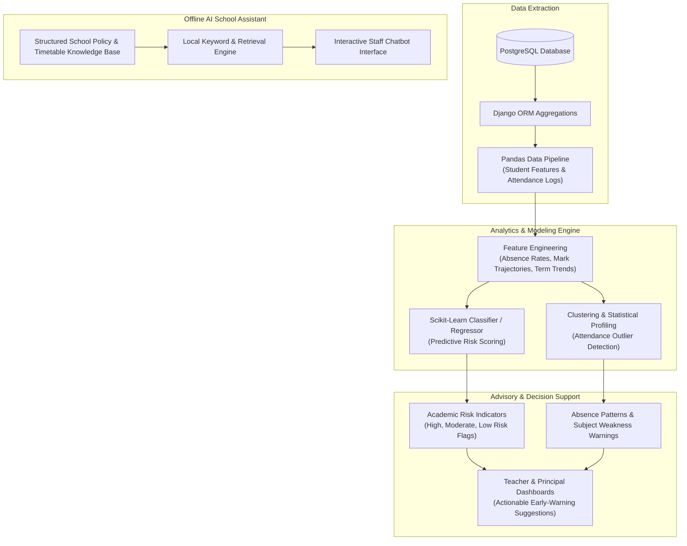

# System Architecture Specification

This document details the architectural design of the **Smart School Management and Academic Information System (SSMS)**, covering the backend, database, frontend, AI analytics integration, and local area network (LAN) deployment.

---

## 1. High-Level System Architecture

The system is built as a centralized, offline-first client-server application designed to operate reliably within a school local area network.

```
 +-----------------------------------------------------------------------------------------+
 |                                  CLIENT TIER (Web Browsers)                             |
 |  Lab PCs (1-20+), Principal Office, Registrar Office, Staff Room (Laptops & Desktops)   |
 +-----------------------------------------------------------------------------------------+
                                             │  HTTP / LAN Requests (e.g. 192.168.1.100:8000)
                                             ▼
 +-----------------------------------------------------------------------------------------+
 |                        LOCAL AREA NETWORK (Ethernet Switch & Wi-Fi)                     |
 |                       Operates completely offline without Internet                      |
 +-----------------------------------------------------------------------------------------+
                                             │
                                             ▼
 +-----------------------------------------------------------------------------------------+
 |                            CENTRAL SCHOOL SERVER HOST MACHINE                           |
 |                                                                                         |
 |   +─────────────────────────────────────────────────────────────────────────────────+   |
 |   |                          WSGI Web Server (Waitress / Gunicorn)                  |   |
 |   +─────────────────────────────────────────────────────────────────────────────────+   |
 |                                           │                                             |
 |   +───────────────────────────────────────▼─────────────────────────────────────────+   |
 |   |                               DJANGO BACKEND ENGINE                             |   |
 |   |                                                                                 |   |
 |   |  • Core Auth & RBAC (accounts)         • Attendance Management (attendance)     |   |
 |   |  • Academic Setup (academics)          • Examination & Marks (examinations)     |   |
 |   |  • Student Records (students)          • Report Cards & Transcripts (reports)   |   |
 |   |  • Staff & Allocations (teachers)      • Security & Audit Logs (audit)          |   |
 |   |  • Timetable Schedules (timetable)     • Backup & Recovery (backup)             |   |
 |   +─────────────────────────────────────────────────────────────────────────────────+   |
 |                       │                                           │                     |
 |                       ▼                                           ▼                     |
 |   +───────────────────────────────────────+   +─────────────────────────────────────+   |
 |   |            DATA ACCESS LAYER          |   |          AI & ANALYTICS ENGINE      |   |
 |   |               (Django ORM)            |   |                                     |   |
 |   +───────────────────────────────────────+   |   • Scikit-Learn (Predictive ML)    |   |
 |                       │                       |   • Pandas & NumPy (Dataframes)     |   |
 |                       ▼                       |   • Offline Assistant Logic         |   |
 |   +───────────────────────────────────────+   +─────────────────────────────────────+   |
 |   |       PostgreSQL DATABASE ENGINE      |                                             |   |
 |   |                                       |                                             |   |
 |   |   • Relational ACID Schemas           |                                             |   |
 |   |   • Foreign Keys, Indexes, Triggers   |                                             |   |
 |   |   • WAL Protection Against Outages    |                                             |   |
 |   +───────────────────────────────────────+                                             |   |
 |                       │                                                                 |
 |                       ▼ (Daily Automated Snapshots)                                     |
 |   +─────────────────────────────────────────────────────────────────────────────────+   |
 |   |      STORAGE & BACKUPS: Local Server Hard Drive & Secondary External USB Drive  |   |
 |   +─────────────────────────────────────────────────────────────────────────────────+   |
 +-----------------------------------------------------------------------------------------+
```

---

## 2. Django Backend Architecture

The backend is built with **Python** and **Django**, organized into independent, reusable application modules ("apps"). Each app follows the Model-View-Template (MVT) pattern:

### 2.1 Django Modular Application Structure
* **`apps.accounts`**: Custom user model (`CustomUser`), authentication views, role definitions, password management, and permission decorators.
* **`apps.academics`**: Configuration of Academic Years, Semesters, Grade Levels (9–12), Sections, Curriculum Streams (Natural/Social), and Subjects.
* **`apps.students`**: Student personal dossiers, enrollment records, status transitions, and search indexing.
* **`apps.teachers`**: Teacher professional profiles, subject qualifications, and teaching workload assignments.
* **`apps.timetable`**: Weekly scheduling grid, room assignments, period management, and collision detection.
* **`apps.attendance`**: High-speed daily/period attendance recording, absence counters, and chronic absenteeism triggers.
* **`apps.examinations`**: Assessment schemes, exam calendar, marks entry with numeric bounds validation, and grade calculations.
* **`apps.reports`**: Printable PDF and HTML report cards, class broadsheets, transcripts, and Ministry of Education statistics.
* **`apps.audit`**: System-wide activity tracking, logging user actions, IP addresses, and data changes.
* **`apps.ai_engine`**: Machine learning models for student performance prediction, attendance clustering, and the offline advisory chatbot.
* **`apps.backup`**: Database snapshot generation, archival routines, and restoration scripts.

---

## 3. Database Architecture (PostgreSQL)

The primary database is **PostgreSQL**, selected for its robustness, enterprise reliability, and strict compliance with ACID standards.

### 3.1 Key Database Entities & Relationships
1. **User & Roles:**
   * `CustomUser` links to a `UserRole` (Principal, Registrar, Teacher, SysAdmin).
2. **Academic Structure:**
   * `AcademicYear` (1) ── (Many) `Semester`
   * `GradeLevel` (1) ── (Many) `Section`
   * `Stream` (1) ── (Many) `Subject`
   * `Subject` links to `GradeLevel` and `Stream`
3. **Student Enrollment & Records:**
   * `Student` (1) ── (Many) `StudentEnrollment`
   * `StudentEnrollment` joins `Student`, `AcademicYear`, `GradeLevel`, `Section`, and `Stream`.
4. **Attendance:**
   * `AttendanceRecord` joins `StudentEnrollment`, `Date`, `Status` (Present, Absent, Late, Excused), and `RecordedBy` (Teacher).
5. **Examinations & Marks:**
   * `AssessmentStructure` (e.g., Continuous Assessment 30%, Midterm 20%, Final 50%).
   * `StudentMark` links `StudentEnrollment`, `Subject`, `AssessmentStructure`, `ScoreObtained`, and `IsLocked`.
6. **Audit Trail:**
   * `AuditLog` stores `Timestamp`, `ActorUser`, `IPAddress`, `ActionType`, `EntityName`, `RecordID`, and `ChangePayload` (JSON).

### 3.2 Performance and Integrity Indexing
* Composite unique constraints: A student cannot have multiple enrollments in the same academic year; a student cannot have duplicate marks for the same assessment in the same subject.
* B-Tree indexes on frequently filtered fields: `student_id`, `academic_year_id`, `grade_level_id`, `section_id`, and `date`.

---

## 4. Frontend Architecture (Offline-First UI)

The frontend is built with **HTML5, CSS3, JavaScript, and Bootstrap 5**, strictly optimized for local hosting without internet dependencies.

### 4.1 Asset Bundling & Zero-CDN Policy
* **Bootstrap 5.3 (CSS & JS):** Packaged directly within the project's `static/vendor/bootstrap/` directory.
* **Bootstrap Icons:** Packaged locally as SVG sprites and self-hosted web fonts within `static/vendor/bootstrap-icons/`.
* **Chart.js:** Packaged locally within `static/vendor/chartjs/` for interactive dashboard visualizations.
* **No External CDNs:** No links to `cdnjs.cloudflare.com`, `googleapis.com`, or other third-party servers. All styling and scripts load reliably over the school's disconnected LAN.

### 4.2 UI Layout Strategy
* **Base Layout (`base.html`):** Clean header with user identity badge and active semester indicator, collapsible sidebar navigation, breadcrumbs, Django flash message container, and main content canvas.
* **Color Palette:**
  * Background: Pure white `#ffffff` and subtle background gray `#f8f9fa`.
  * Primary Accent: Deep Navy Blue `#1e3a8a` (represents stability and academic authority).
  * Secondary Accent: Slate Teal `#0d9488` (for positive metrics and active buttons).
  * Neutral Dark: Charcoal `#1f2937` (for readable, high-contrast typography).
  * Warning / Risk: Soft Amber `#d97706` (for moderate risk) and Crimson `#dc2626` (for high academic or attendance risk).
* **Print Stylesheet (`print.css`):** Formats report cards and broadsheets cleanly for standard A4 paper, hiding sidebars, navigation bars, and buttons.

---

## 5. AI Integration Architecture

The Artificial Intelligence subsystem operates completely on the local server machine using Python data science libraries.



### 5.1 AI Operating Principles
1. **Advisory Only:** Predictions and suggestions are presented as recommendations for human teachers and principals. The AI has **no authority** to alter grades, expel students, or execute promotions.
2. **Local Execution:** Models are trained and executed locally on the server using `scikit-learn`. No student data is ever sent to external cloud APIs.
3. **Data Privacy:** All training and inference happen strictly within the school's local database boundaries.

---

## 6. LAN Deployment Architecture (Host & Clients)

### 6.1 Server Hardware Recommendations
* **Processor:** Modern multi-core x64 CPU (e.g., Intel Core i5 / AMD Ryzen 5 or higher).
* **RAM:** 8 GB minimum (16 GB recommended for running Django, PostgreSQL, and AI analytics simultaneously).
* **Storage:** 256 GB SSD (fast read/write for database operations) + Secondary External USB Hard Drive for daily backups.
* **Operating System:** Windows 10/11 Pro or Windows Server / Ubuntu Linux.

### 6.2 Network Configuration
* **Server IP Address:** The host computer is configured with a **Static Local IP Address** (e.g., `192.168.1.100`) via the school router's DHCP reservation.
* **Port:** Served on port `8000` (development/testing) or standard port `80` using a production WSGI runner (Waitress on Windows).
* **Client Access:** Lab computers open any web browser and navigate to:
  ```
  http://192.168.1.100:8000
  ```
* **Firewall Configuration:** A single inbound TCP rule on port `8000` is opened in Windows Defender Firewall for the private local network profile.
