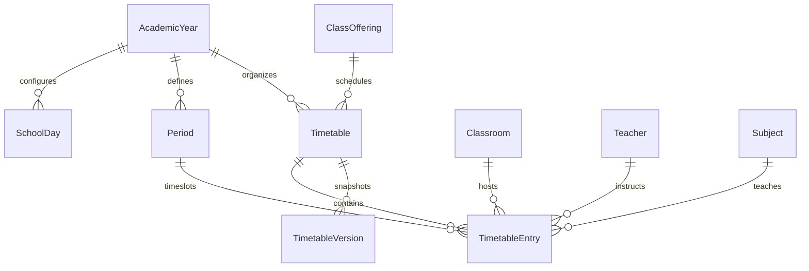
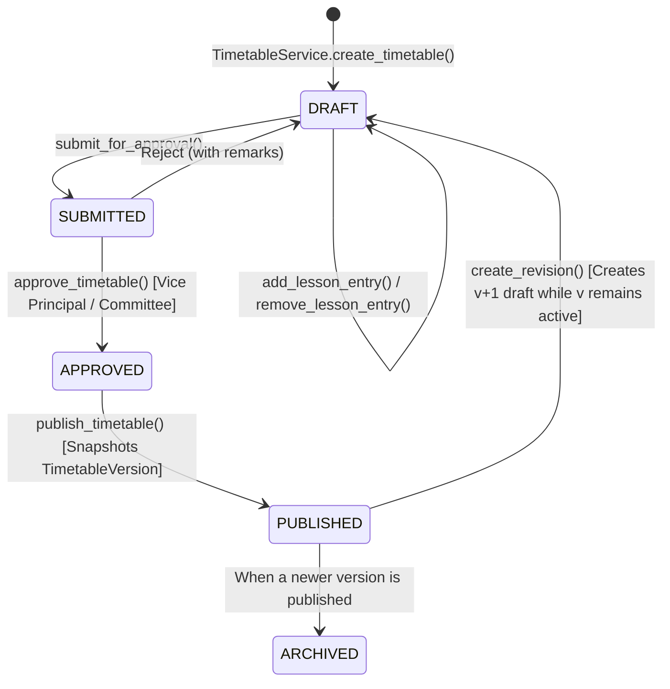

# STEP 14: TIMETABLE AND CLASS SCHEDULING MANAGEMENT SYSTEM
## Technical Architecture & Operational Guide

**Project:** Smart School Management and Academic Information System (SSMS)  
**Target Environment:** Secondary School (Grades 9–12, 1,000–2,000 Students), Majang Zone, Gambella Region, Ethiopia  
**Deployment Infrastructure:** Offline Local Area Network (LAN)  
**Django App:** `timetable`  
**Date:** November 2026  

---

## 1. Executive Summary & Module Purpose

In secondary schools operating in regional settings such as the Majang Zone, class timetabling and room allocations were historically drafted on physical chart boards or paper matrices. This manual process frequently caused:
1. **Teacher Double-Booking:** Instructors accidentally scheduled in two classes simultaneously.
2. **Room Collisions:** Multiple classes arriving at the same physical classroom or science laboratory.
3. **Class Schedule Overlaps:** A student section assigned two subjects concurrently.
4. **Instruction on Break Periods:** Academic subjects inadvertently placed in morning recess or lunch intervals.
5. **Loss of Historical Records:** Mid-year curriculum shifts and schedule revisions overwrite past operational data without audit history.

**Step 14** delivers a production-grade, offline-first **Timetable and Class Scheduling Management System** integrated into the existing Django architecture. It provides configurable school working days and period schedules, physical classroom tracking, conflict-prevention algorithms, weekly visual matrices for both student classes and teachers, formal review/approval workflows, immutable revision snapshots, and high-fidelity PDF and Excel export generation.

---

## 2. Architectural Overview & Database Schema

The `timetable` application leverages existing core models (`AcademicYear`, `ClassOffering`, `Subject`, `Teacher`, `TeacherAssignment`, and `User`) without data duplication.



### 2.1 Models Summary

1. **`Classroom`**:
   - Represents physical learning spaces (e.g., standard classrooms, physics lab, chemistry lab, ICT lab, library).
   - Fields: `name`, `code` (unique uppercase, e.g. `R-101`, `LAB-PHY`), `building`, `room_type`, `capacity`, `is_active`, `description`.
   - Rooms can be safely deactivated without breaking historical schedules.

2. **`SchoolDay`**:
   - Configurable school operational days per academic year or global default.
   - Fields: `academic_year`, `day_of_week` (1=Monday ... 7=Sunday), `name`, `short_name`, `is_active`, `order`.
   - Supports 5-day (Mon-Fri) or 6-day (Mon-Sat) Ethiopian secondary school schedules.

3. **`Period`**:
   - Configurable period structure with exact start/end times and break flags.
   - Fields: `academic_year`, `period_number`, `name`, `start_time`, `end_time`, `is_break`, `break_type` (`RECESS`, `LUNCH`, `ASSEMBLY`, `OTHER`), `is_active`.
   - Instructional lessons cannot be placed during break periods.

4. **`Timetable`**:
   - Root schedule entity bound to an `academic_year` and `class_offering`.
   - Versioned integer (`version=1, 2, ...`).
   - State Machine: `DRAFT` ➔ `SUBMITTED` ➔ `APPROVED` ➔ `PUBLISHED` ➔ `ARCHIVED`.
   - Audit trail: `created_by`, `approved_by`, `approved_at`, `remarks`.

5. **`TimetableEntry`**:
   - Atomic lesson slot mapping a `timetable`, `day_of_week`, `period`, `subject`, `teacher`, and optional `classroom`.
   - Unique constraint: `(timetable, day_of_week, period)` ensures one lesson per slot within a class timetable.

6. **`TimetableVersion`**:
   - Immutable historical record containing a complete JSON snapshot of all entries, classroom allocations, and metadata at the time of publication or revision.

---

## 3. Conflict Detection Engine (`ConflictDetectionService`)

The core scheduling engine detects and prevents scheduling errors across 4 distinct dimensions:

| Conflict Type | Description | Resolution / Enforcement |
| :--- | :--- | :--- |
| **Teacher Double-Booking** | Teacher scheduled in another class at the same day & period across any active/draft timetable. | **Hard Block** (ValidationError raised). Engine lists conflicting class, subject, and timetable. |
| **Class Double-Booking** | The same student class scheduled for two different subjects at the same period. | **Hard Block** (ValidationError raised). |
| **Classroom Collision** | Physical classroom allocated to another class at the same day & period. | **Hard Block** (ValidationError raised). |
| **Break Slot Violation** | Attempt to schedule an instructional lesson into a recess, lunch, or assembly slot. | **Hard Block** (ValidationError raised). |
| **Inactive Entity** | Teacher on leave/inactive or classroom deactivated. | **Hard Block** (ValidationError raised). |
| **Assignment Mismatch** | Teacher assigned to teach a subject not in their official `TeacherAssignment` record. | **Warning** (Flagged for review, permits manual administrative override). |

### Alternative Period Recommendations
When a collision is detected during manual lesson entry, `ConflictDetectionService.suggest_alternative_periods` scans all non-break active periods on the specified day, evaluates teacher and classroom availability, and presents free slots to the user interface.

---

## 4. Lifecycle & Governance Workflow



1. **Drafting Phase:** Head Teachers, Academic Vice Principals, or Schedulers create draft timetables, allocate subjects, teachers, and rooms with live conflict checking.
2. **Review & Committee Approval:** Draft is submitted with review notes. Academic Committee reviews conflict reports, approves or sends back for amendment.
3. **Publication:** Publishing activates the timetable, flags any previous published version for that class as `ARCHIVED`, and creates an immutable JSON snapshot in `TimetableVersion`.
4. **Mid-Year Revisions:** Modifying a live schedule requires triggering `create_revision()`. This generates a `v(N+1)` draft populated with existing lessons, allowing the school to adjust assignments without interrupting the active published schedule until the revision is re-approved and published.

---

## 5. Visual Matrices & Weekly Views

The `TimetableMatrixService` computes 2D grids mapping periods (rows) against working days (columns):
- **Class Timetable Matrix:** Displays subject name, teacher name, and classroom code for every period of the week. Break periods are visually demarcated across the entire row.
- **Teacher Timetable Matrix:** Aggregates all classes taught by an individual instructor across all active class timetables in the academic year. Demonstrates instructor free periods, contact hours, and classroom locations.
- **Live Conflict Audit Dashboard:** Real-time diagnostics view aggregating all active schedules, detecting cross-class anomalies or unassigned slots.

---

## 6. PDF and Excel Export System

Under offline LAN conditions in Ethiopia, paper copies are essential for noticeboards, classroom doors, and teacher binders:
- **PDF Generation (`ReportLab`):**
  - High-resolution A4 landscape document.
  - Institutional header with Ministry of Education / Majang Zone branding.
  - Formatted timetable grid with crisp borders, period timings, teacher abbreviations, and signature block for the School Director.
- **Excel Generation (`openpyxl`):**
  - Styled spreadsheet with auto-adjusted column widths, centered alignment, color-coded break rows, and cell borders.
  - Downloadable for offline archival and staff distribution.

---

## 7. Role-Based Access Control (RBAC) & Security

| Role | Permissions |
| :--- | :--- |
| **Admin / Academic Director** | Full CRUD on working days, periods, classrooms, timetables, and approval/publication authority. |
| **Vice Principal / Committee** | Timetable review, conflict auditing, approval, rejection, and publication. |
| **Teachers** | Read-only access to their personal weekly timetable matrix, assigned classrooms, and class schedules. |
| **Students / Parents** | Read-only access to their published section's weekly timetable. |

All administrative modifications, creations, approvals, and revisions are logged in `core.models.AuditLog`.

---

## 8. Verification & Test Execution Results

The module is verified with an automated test suite comprising 21 test cases:

```powershell
python manage.py test timetable --verbosity=2
```

### Coverage Highlights:
- Default working day provisioning (Monday–Friday) and 8 daily period slots with breaks.
- Classroom creation, unique code enforcement, and active state toggles.
- Timetable creation, lesson scheduling, and class offering cloning.
- Strict multi-dimensional conflict detection:
  - Teacher double-booking prevention.
  - Class double-booking prevention.
  - Classroom double-booking prevention.
  - Break slot lesson blocking.
- Alternative period recommendation algorithm.
- Multi-step governance workflow (Draft ➔ Submitted ➔ Approved ➔ Published ➔ Archived).
- Immutable JSON version snapshot creation and audit verification.
- Revision cloning (v1 remains published while v2 draft is edited).
- Class and teacher timetable matrix visual data structures.
- PDF and Excel export binary generation.
- Full HTTP view and access control verification across all 19 URLs.
