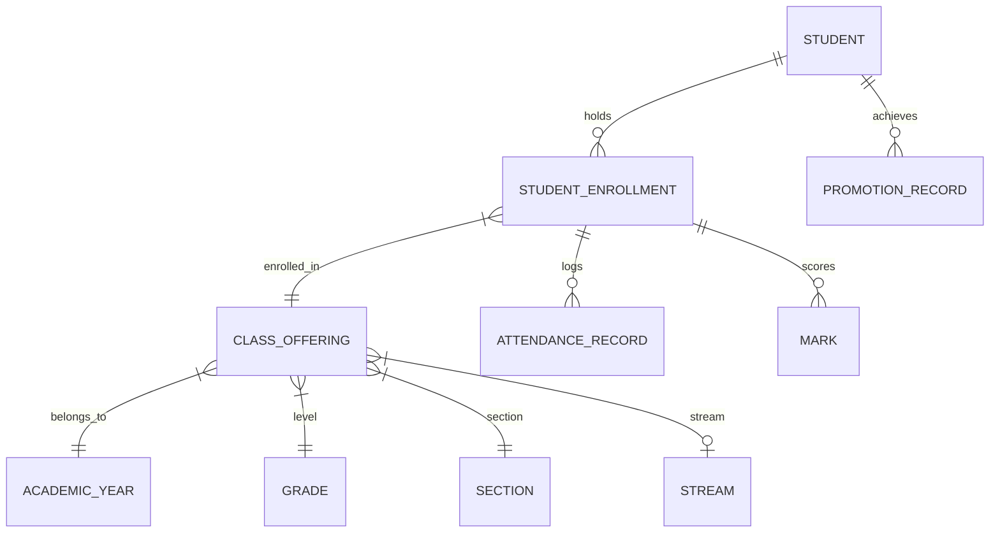

# Student Management System Documentation (Step 8)
**Smart School Management and Academic Information System (SSMS)**  
**Majang Zone Secondary School (Grades 9–12), Gambella Region, Ethiopia**  
*Module Version: 1.0 — Implemented November 2, 2026*

---

## 1. Overview & Architecture

The **Student Management System** is the core operational module of SSMS. It provides comprehensive record-keeping, admission management, classroom allocations, profile management, and longitudinal academic tracking for students across Grades 9–12.

The implementation strictly maintains relational integrity with existing academic and administrative data models, preserving longitudinal enrollment and performance histories without destructive deletions.



---

## 2. Student Registration Workflow

### Step-by-Step Procedure
1. **Initiation**: The Registrar navigates to the Student Directory (`/students/`) and clicks **"Register Student"** (`/students/register/`).
2. **Admission Number Allocation**:
   - By default, the system automatically suggests the next sequential admission number (e.g. `SSMS/2026/0001`).
   - If enrolling a student with an existing legacy or transfer file number, the Registrar can uncheck *"Auto-generate Admission Number"* and enter a validated custom identifier (e.g., `MAJ-SEC/2026/0450`).
3. **Identity & Demographics**:
   - The Registrar completes the mandatory **Ethiopian three-part naming** fields (*Given Name*, *Father's Name*, *Grandfather's Name*).
   - Specifies *Gender* (Male/Female) and *Date of Birth* (validated to ensure student is between 10 and 30 years old).
   - Optionally uploads a verified portrait photograph (validated for file size, extension, and binary structure).
4. **Contact & Guardian Data**:
   - Fills in primary residential village/kebele in Majang Zone.
   - Enters primary parent or emergency guardian name, contact phone number, and relationship.
5. **Classroom Allocation**:
   - Optionally selects the active academic year and class offering (e.g., `Grade 9 - Section A (General Secondary)`).
   - When selected, a `StudentEnrollment` record is created atomically within the same transaction.
6. **Audit & Confirmation**:
   - The student record is saved.
   - An immutable `CREATE` entry is written to `AuditLog`.
   - The system displays a success message and redirects to the student's profile.

---

## 3. Student Information Fields

| Field Name | Type | Constraint | Purpose / Description |
| :--- | :--- | :--- | :--- |
| `admission_number` | CharField(50) | Unique, Indexed | Unique institutional student identifier (e.g., `SSMS/2026/0001`). |
| `first_name` | CharField(50) | Mandatory | Student given name. |
| `father_name` | CharField(50) | Mandatory | Father's name. |
| `grandfather_name` | CharField(50) | Mandatory | Grandfather's name. |
| `gender` | CharField(1) | 'M' / 'F' | Biological sex as required by Ministry of Education rosters. |
| `date_of_birth` | DateField | Mandatory | Validated between 10 and 30 years old. |
| `photo` | ImageField | Optional | Stored securely in `media/students/photos/` with randomized UUID filename. |
| `phone_number` | CharField(30) | Optional | Personal or family mobile phone. |
| `address` | CharField(255) | Optional | Residential kebele/woreda in Majang Zone. |
| `emergency_contact_name` | CharField(100) | Mandatory | Primary guardian or parent full name. |
| `emergency_contact_phone` | CharField(30) | Mandatory | Primary emergency contact number. |
| `emergency_contact_relation`| CharField(50) | Mandatory | Relationship (Father, Mother, Guardian, Uncle, etc.). |
| `admission_date` | DateField | Auto `now_add` | Date record was created. |
| `status` | CharField(20) | Active/Transferred/Withdrawn/Dropped/Graduated | Current administrative enrollment status. |

---

## 4. Admission Number Generation & Validation

The admission number system is implemented via `AdmissionNumberService` (`students/services.py`).

### Standard Format: `SSMS/{YEAR}/{SEQUENCE}`
- **Prefix**: Configurable institutional prefix (default: `SSMS`).
- **Year**: 4-digit calendar year derived from the active `AcademicYear` (e.g. `2026`).
- **Sequence**: 4-digit zero-padded incremental sequence (`0001`, `0002`, ...).

### Concurrency & Validation
- **Race Condition Prevention**: Sequence calculations and reservations execute inside atomic database transactions (`transaction.atomic()`).
- **Validation**:
  - Uniqueness is strictly verified across all records.
  - Allowed characters: alphanumeric characters, `/`, `-`, and `_`.
  - Manual entries for transferred or legacy paper records are validated to ensure compliance with school policy.

---

## 5. Classroom Enrollment Workflow

1. **Academic Year Selection**: Must be an open academic year (`is_closed=False`).
2. **Class Offering Selection**: Filtered to offerings belonging to the chosen academic year.
3. **Duplicate Prevention**:
   - `StudentEnrollment` enforces a database constraint:
     ```python
     models.UniqueConstraint(
         fields=['student', 'academic_year'],
         name='unique_student_enrollment_per_year'
     )
     ```
   - Attempting to enroll a student in multiple classes for the same academic year is blocked both at the form layer and at the database constraint level.
4. **Historical Preservation**:
   - Previous years' enrollment records remain completely intact.
   - Longitudinal progress (Grade 9 &rarr; 10 &rarr; 11 &rarr; 12) is viewable chronologically on the student's profile.

---

## 6. Student Status Transitions & Soft Deletion

Under Ministry of Education and regional secondary school policies, student academic records must never be permanently deleted once marks, attendance, or enrollment records exist.

The system supports the following managed statuses:
- **`ACTIVE`**: Actively attending classes and sitting for examinations.
- **`TRANSFERRED`**: Transferred out to another secondary school.
- **`WITHDRAWN`**: Withdrawn from the school by parent or personal request.
- **`DROPPED`**: Discontinued attendance without formal notification.
- **`GRADUATED`**: Successfully completed Grade 12 national curriculum.

### Status Update Protocol
- Restricted to **Registrars** via `student_status_view`.
- Requires mandatory written remarks/reference (e.g., Transfer Certificate letter number).
- Automatically updates current active enrollments to `WITHDRAWN` when a student leaves the school.
- Logs a comprehensive audit event in `AuditLog` capturing old status, new status, and remarks.

---

## 7. File Upload Security

Student photographs are protected by `FileUploadSecurityService`:
1. **Extension Whitelist**: Only `.jpg`, `.jpeg`, `.png`, and `.webp` are permitted.
2. **File Size Limit**: Maximum file size is strictly capped at **2MB** (2,097,152 bytes).
3. **Magic Byte Inspection via PIL**: Uploaded files are opened and verified using Pillow (`img.verify()`). Renamed executable binaries (`.exe`, `.sh`, `.php`) disguised with an image extension are rejected with validation errors.
4. **Path & Filename Sanitization**:
   - Filenames are replaced with random UUIDs (`uuid.uuid4().hex + ext`).
   - Stored in `media/students/photos/` without user-controlled filenames, preventing directory traversal and file overwrite vulnerabilities.

---

## 8. Role-Based Access Control Matrix

| Feature / URL | Principal | Registrar | Teacher | System Administrator | Anonymous |
| :--- | :---: | :---: | :---: | :---: | :---: |
| **View Student Directory** (`/students/`) | ✅ Full | ✅ Full | 🔒 Assigned Classes Only | ✅ Full | ❌ Redirect to Login |
| **Register New Student** (`/students/register/`) | ❌ 403 | ✅ Full | ❌ 403 | ❌ 403 (unless Registrar role) | ❌ Redirect to Login |
| **View Student Profile** (`/students/<id>/`) | ✅ Full | ✅ Full | 🔒 Assigned Students Only (403 otherwise) | ✅ Full | ❌ Redirect to Login |
| **Edit Student Profile** (`/students/<id>/edit/`) | ❌ 403 | ✅ Full | ❌ 403 | ❌ 403 (unless Registrar role) | ❌ Redirect to Login |
| **Classroom Enrollment** (`/students/<id>/enroll/`) | ❌ 403 | ✅ Full | ❌ 403 | ❌ 403 | ❌ Redirect to Login |
| **Update Status** (`/students/<id>/status/`) | ❌ 403 | ✅ Full | ❌ 403 | ❌ 403 | ❌ Redirect to Login |

---

## 9. Verification & Test Suite Summary

Automated tests in `students/tests.py` verify all components:

| Test Name | Focus | Result |
| :--- | :--- | :---: |
| `test_student_registration_by_registrar` | Auto-generation, enrollment & audit logging | ✅ PASSED |
| `test_duplicate_admission_number_rejected` | Admission number uniqueness | ✅ PASSED |
| `test_custom_admission_number_policy` | Manual custom admission number formatting | ✅ PASSED |
| `test_student_profile_view` | Profile rendering & demographic details | ✅ PASSED |
| `test_student_update_by_registrar` | Profile editing & audit log change diff | ✅ PASSED |
| `test_student_enrollment_in_new_academic_year` | Longitudinal enrollment records preservation | ✅ PASSED |
| `test_duplicate_enrollment_in_same_year_rejected` | Preventing double enrollment per year | ✅ PASSED |
| `test_student_status_transition_preserves_records`| Status transitions (Transferred) & audit trail | ✅ PASSED |
| `test_search_and_filtering` | Search by name/ID, filtering by grade/status | ✅ PASSED |
| `test_pagination` | 20 students/page pagination split | ✅ PASSED |
| `test_file_upload_security` | Genuine image verification & executable blocking | ✅ PASSED |
| `test_role_based_access_control` | Multi-role scoping and unauthorized access blocking | ✅ PASSED |
